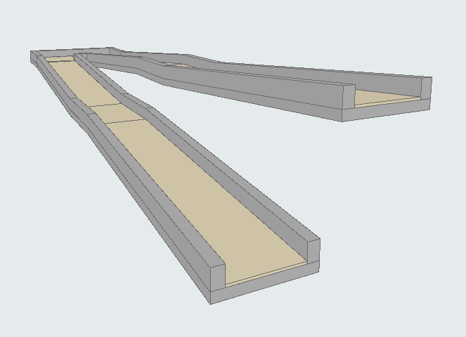
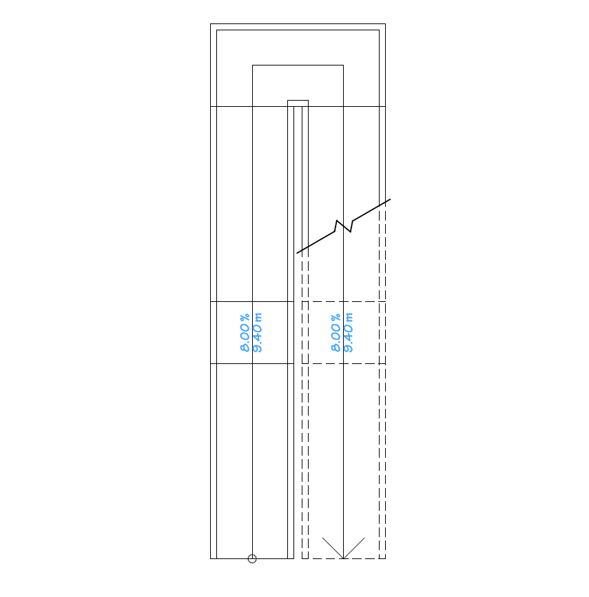
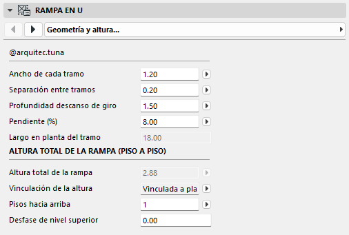
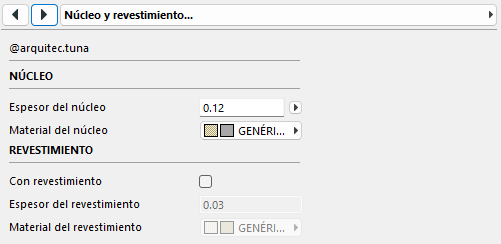
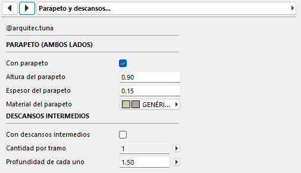
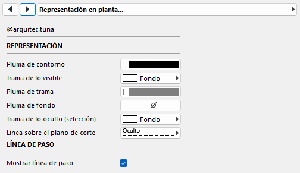
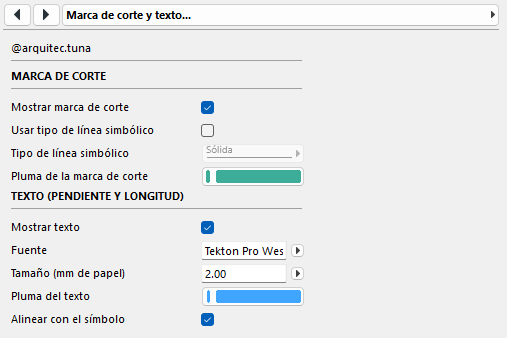

# Rampa en U — objeto GDL paramétrico para Archicad

Objeto paramétrico de rampa en U (dos tramos y descanso) para **Archicad 28**, hecho en GDL por **@arquitec.tuna**.

## Características
- Altura manual o vinculada a la planta superior (piso a piso).
- Pendiente, ancho de tramo, ojo central y descansos (incluye descansos intermedios).
- Núcleo (normalmente hormigón) y revestimiento opcional; nivel 0.00 en la cara superior terminada.
- Parapeto único sobre el núcleo, a ambos lados.
- Representación en planta: relleno seleccionable, marca de corte y línea de paso opcionales.
- Texto de pendiente (%) y longitud inclinada, con fuente, tamaño y pluma configurables.
- Propiedades para cómputo: volumen del núcleo, superficie de revestimiento y superficie vertical de parapetos.

## Interfaz
| | |
|---|---|
|  |  |
|  |  |
|  | |

## Instalación
1. Descargá `Rampa en U 001.gsm` desde [Releases](../../releases).
2. En Archicad: *Archivo > Bibliotecas y Objetos > Administrador de bibliotecas > Agregar* (carpeta que contenga el archivo).
3. Insertá el objeto con la herramienta Objeto.

## Código fuente
Los scripts están en [`src/`](src) y la lista de parámetros con sus tipos en [`docs/`](docs).
Para modificar el objeto, creá los parámetros con los tipos indicados y pegá cada script en su ventana del editor de objetos GDL.

## Versión probada
Archicad 28.

## Licencia
[CC BY 4.0](LICENSE) — libre uso y modificación dando crédito a **@arquitec.tuna**.
